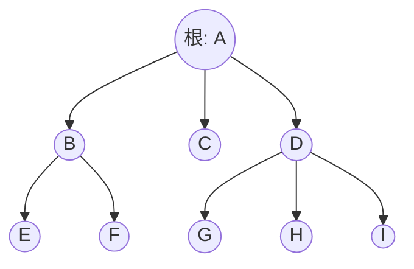
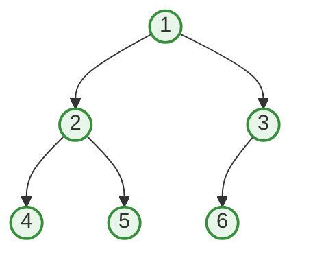

树就是一种存在朝一个方向的一对多，另一个方向则只有一对一的数据类型

树的定义是有n个结点的有限集。在任意非空树种，有且仅有一个特定的**根**结点。当 $n>1$ 时，其余的结点可以分为m个互不相交的有限集，这每个有限集都是另一颗树，称为子树

结点包含一个数据元素，以及若干指向其子树的分支

结点具有度 *(degree)*，表示其拥有的子树数量。度为0的结点称为叶，或者终端结点。度不为0的结点称为分支结点，或者非终端结点，非根结点的分支结点称为内部节点。树的度就是树内各个节点的度的最大值

结点的**子树的根**称为这一结点的孩子 *(child)*，这一结点称为其child的双亲 *(parent)*

拥有同一parent的结点称为兄弟 *(sibling)*

从根到某一结点所经分支上的所有结点称为其祖先

以某一结点为根的子树种的任一结点称为其子孙

树具有层次 *(level)*，从根结点为第一层，其child为第二层，以此类推

树具有深度，也就是树中结点的最大层次数

如果两个结点的parent在同一层但是不同，那么其称为堂兄弟

如果树中的结点具有次序，不能互换，就是有序树，否则为无序树

森林就是m个互不相交的树的集合

每个结点的子树的集合称为这一结点的子树森林

任何一棵树是一个二元组 $(root, Forest)$，root是数据元素，Forest是子树森林，root与Forest中的任意元素 $T_i=(r_i,F_i)$ 存在关系 $<root,r_i>$ *(见离散数学)*
# 树的表示

树可以用图表示



也可以用嵌套的集合表示，也就是韦恩图

也可以用嵌套括号表示

```
(a(b,c));
(a(b(c,d),e(f,g(h,i))))
```

也可以用凹入表示，也就是缩进
# 二叉树

二叉树就是每个结点最多有两个子树的树，分别为左子树和右子树，这两个子树均可为空

```mermaid
graph TD
    %% 二叉树
    A((A)) -->|左| B((B))
    A -->|右| C((C))
    
    B -->|左| D((D))
    B -->|右| E((E))
    
    C -->|右| F((F))
    
    E -->|左| G((G))
````

二叉树的插入较为特殊，对于一个结点，插入会使得其一个子树变为插入的子树，被移除的那个子树又会变成插入子树的右子树，因此要求插入子树的右子树为空

二叉树的第i层最多有 $2^{i-1}$ 个结点。层数 *(高度)* 为k的二叉树总共最多有 $2^k-1$ 个结点

二叉树上，叶总是比分支节点多1个，叶总是比度为2的结点多1个
## 满二叉树

满二叉树的第i层一定有 $2^{i-1}$ 个结点，其编号顺序为从上到下，然后在每一层从左到右

```mermaid
graph TD
    %% 满二叉树（深度为3，共7个节点）
    1((1)) --> 2((2))
    1 --> 3((3))
    
    2 --> 4((4))
    2 --> 5((5))
    
    3 --> 6((6))
    3 --> 7((7))
    
    %% 添加一点样式让结构更清晰
    classDef default fill:#e1f5fe,stroke:#0288d1,stroke-width:2px;
```
## 完全二叉树

对一棵具有 $n$ 个节点的二叉树按层序编号，如果编号为 $i (1 \le i \le n)$ 的节点与**满二叉树**中编号为 $i$ 的节点在树中的位置完全相同，则为完全二叉树。

也就是，除了最后一层外，其他层都是满的；并且最后一层的节点**全部紧靠左边** *(没有任何空挡)*，也就是截去了尾部一些编号的结点



有n个结点的完全二叉树的层数 *(高度)* 为
$$
h=\lfloor \log_2n\rfloor+1
$$
观察可知，完全二叉树中度为1的结点至多有一个

完全二叉树有很好的性质，对于一个编号为i的结点，其左Child的编号为2i，右Child为2i+1。如果结点非根，那么其Parent编号为 $\lfloor \frac i 2 \rfloor$ 
## 存储二叉树

二叉树可以用顺序结构存储。对于一个完全二叉树，只需将其存在的结点存储在一个大小为 $2^n-1$ 的数组中即可。编号为i的结点存储在 $mem[i-1]$ 即可。不过，这种方式会造成很多空间的浪费，并且难以实现插入等操作

通常我们可以使用二叉链表 $[lchild, data, rchild]$ 或者三叉链表 $[lchild, data, parent, rchild]$ 来存储二叉树
## 二叉树的遍历

我们用D表示根结点，L和R表示左和右子树。先序遍历的顺序是DLR，中序是LDR，后序是LRD，这三种遍历都是深度优先的遍历，并且在遍历顺序上无区别，只是在操作结点的时机上有显著区别

层序遍历就是从上到下，从左到右的逐层遍历，这些遍历都是递归的
### 先序

```cpp
void preorderTraversal(TreeNode* root) {
    if (root == nullptr) return;
    
    doSomething(root);               // 1. 操作当前节点 (根)
    preorderTraversal(root->left);   // 2. 遍历左子树
    preorderTraversal(root->right);  // 3. 遍历右子树
}
```

这种遍历方法不会先访问到底
### 中序

```cpp
void inorderTraversal(TreeNode* root) {
    if (root == nullptr) return;
    
    inorderTraversal(root->left);    // 1. 遍历左子树
    doSomething(root);               // 2. 操作当前节点 (根)
    inorderTraversal(root->right);   // 3. 遍历右子树
}
```

这种遍历方法会先访问到底
### 后序

```cpp
void postorderTraversal(TreeNode* root) {
    if (root == nullptr) return;
    
    postorderTraversal(root->left);  // 1. 遍历左子树
    postorderTraversal(root->right); // 2. 遍历右子树
    doSomething(root);               // 3. 操作当前节点 (根)
}
```

这种遍历方法也会先访问到底