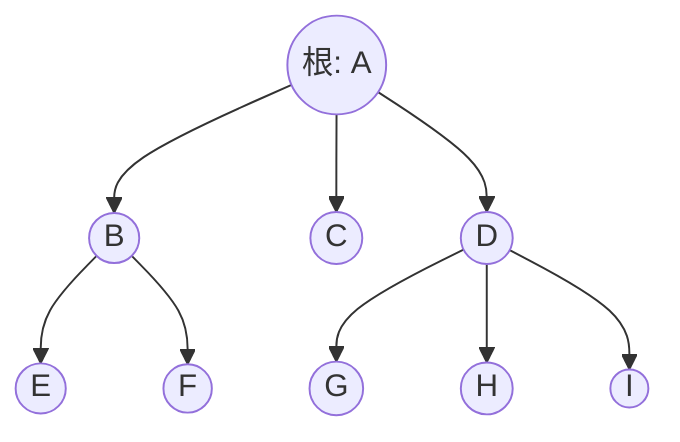

树就是一种存在朝一个方向的一对多，另一个方向则只有一对一的数据类型

树的定义是有n个结点的有限集。在任意非空树种，有且仅有一个特定的**根**结点。当 $n>1$ 时，其余的结点可以分为m个互不相交的有限集，这每个有限集都是另一颗树，称为子树

结点包含一个数据元素，以及若干指向其子树的分支

结点具有度 *(degree)*，表示其拥有的子树数量。度为0的结点称为叶，或者终端结点。度不为0的结点称为分支结点，或者非终端结点，非根结点的分支结点称为内部节点。树的度就是树内各个节点的度的最大值

结点的**子树的根**称为这一结点的孩子 *(child)*，这一结点称为其child的双亲 *(parent)*

拥有同一parent的结点称为兄弟 *(sibling)*

从根到某一结点所经分支上的所有结点称为其祖先

以某一结点为根的子树种的任一结点称为其子孙

树具有层次 *(level)*，从根结点为第一层，其child为第二层，以此类推

树具有深度，也就是树中结点的最大层次数

如果两个结点的parent在同一层但是不同，那么其称为堂兄弟

如果树中的结点具有次序，不能互换，就是有序树，否则为无序树

森林就是m个互不相交的树的集合

每个结点的子树的集合称为这一结点的子树森林

任何一棵树是一个二元组 $(root, Forest)$，root是数据元素，Forest是子树森林，root与Forest中的任意元素 $T_i=(r_i,F_i)$ 存在关系 $<root,r_i>$ *(见离散数学)*
# 树的表示

树可以用图表示



也可以用嵌套的集合表示，也就是韦恩图

也可以用嵌套括号表示

```
(a(b,c));
(a(b(c,d),e(f,g(h,i))))
```

也可以用凹入表示，也就是缩进
# 二叉树

